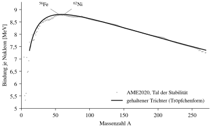
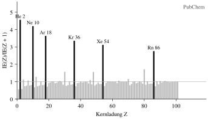
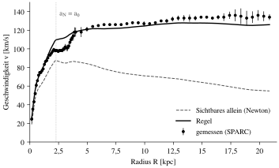
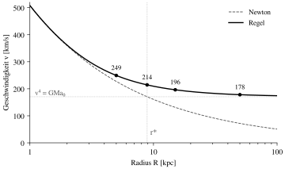
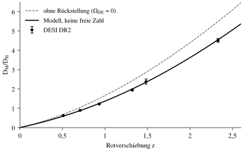
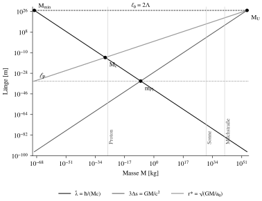

# Was sich rechnen lässt

**Zehn Beispiele an unseren Daten: vom Atom bis zum Ganzen**

Francesco Silvano Schauer

---

## Die Kette

Das Modell rechnet mit wenigen Eingaben und wenigen Formeln. Eingaben sind die Naturkonstanten (c, G, ħ, die Feinstrukturkonstante α), die Masse des Körpers und eine einzige Schwelle, a₀ = 1,06·10⁻¹⁰ m/s². Für das Ganze kommen drei Messwerte hinzu (Planck): die Baryonen ω_b, die Strahlung über T_CMB und ω_c. ω_c ist kein eigener Stoff, sondern das Gewicht der Rückkehr im Ganzen, Q = ω_c/ω_b. Alles andere folgt.

| Was | Formel | Was sie gibt |
|---|---|---|
| Faltung | Δs = GM/(3c²) | das Maß der Masse: die zusätzliche Strecke im Zentrum des Trichters |
| Neigung | g = 3c²Δs/r² | die Fallbeschleunigung, Newton |
| Takt | dτ/dt = √(1 − 6Δs/r) | den Gang der Uhren im Trichter |
| Rückkehr | a = a_N/(1 − q), q = e^{−√(a_N/a₀)} | die Bewegung bei jeder Beschleunigung: Newton oberhalb von a₀, flache Rotationskurven darunter |
| Schwellenradius | r* = √(GM/a₀) | wo ein Körper die Schwelle erreicht |
| Atmen | ρ_DE = 3π³a₀²/(30Gc²) | die Dunkle Energie und mit ihr H₀ und Ω_DE |
| Umlauf der Hülle | v = αc auf a_B | die Bindung des Atoms |
| Halter des Kerns | a_C = (3/5)·αħc/λ_H | die Länge, auf der der Kern seine Nukleonen hält |

Der **Rückkehranteil** q ist der Teil einer Bewegung, der durch die innere Richtung zurückkehrt. a_N ist die Beschleunigung, die Newton allein aus der sichtbaren Masse gäbe. Oberhalb der Schwelle ist q fast null und die Regel ist Newton. Darunter wächst q und hält die Bahnen (Bild 1). Die Schwelle ist überall dieselbe: In Galaxien, im Abstand der Supernovae und im Atmen des Ganzen wird dieselbe Zahl gelesen.

Was so sauber rechenbar ist:

- **Teilchen und Kern:** Bindung des Wasserstoffs, die Halterlänge des Kerns aus AME2020, die Schließzahlen der Hüllen und Kerne, das Ende der Stoffe bei Z = 118.
- **Sterne und Galaxien:** die Rotationskurve aus dem Sichtbaren allein, die Schwelle aus 141 Galaxien (SPARC), die Scheibenlänge R_d = r*/√2.
- **Das Ganze:** H₀ = 67,2 km/s/Mpc und Ω_DE = 0,685 aus a₀ und den drei Messwerten des Ganzen, die Form der Ausdehnung an Supernovae (Pantheon+) und BAO (DESI DR2).

Zehn Beispiele folgen, Schritt für Schritt, vom Atom bis zum Ganzen.


---

## Beispiel 1: Atom und Kern

**Wasserstoff.** Die Hülle des Wasserstoffs ist ein schnell umlaufender Wirbel: Sie läuft mit v = αc auf dem Bohr-Radius a_B um. Ihre Bindung ist die Energie dieses Umlaufs, E = ½μv², mit μ der reduzierten Masse von Elektron und Proton, weil beide um den gemeinsamen Schwerpunkt laufen:

```
E = ½ · μ · (αc)² = **13,598 eV**
```

Gemessen (PubChem): **13,598 eV**. Keine angepasste Zahl steht dazwischen.

**Der Kern.** Der Kern ist ein gehaltener Trichter. Die Länge, auf der er seine Nukleonen hält, steckt im Coulomb-Glied der Bindung. An alle Kerne der AME2020 angepasst (Bild 2), ist dieses Glied a_C = 0,69 MeV, und daraus

```
λ_H = (3/5)·αħc / a_C = **1,25 fm**     R(⁵⁶Fe) = λ_H · 56^{1/3} = **4,8 fm**
```

Dieselbe Länge kommt auf einem zweiten, unabhängigen Weg: Spiegelkerne, in denen Protonen und Neutronen vertauscht sind, unterscheiden sich nur in der Windung. Ihr Bindungsunterschied gibt **1,33 fm**. Und das Tempo der Nukleonen im Halter lässt sich zweimal lesen: aus der Größe, v/c ≈ λ̄_p/λ_H = **0,17**, und aus der Tiefe der Bindung von ⁶²Ni, **0,14**. Größe und Bindung lesen dasselbe.



---

## Beispiel 2: Das Sonnensystem

Der Trichter von Erde und Sonne, ohne Rückkehr: Alle Zahlen folgen aus der Faltung Δs = GM/(3c²) und dem Takt dτ/dt = √(1 − 6Δs/r).

| Körper | Faltung Δs | Grenzradius r₀ = 6Δs | Uhr an der Oberfläche, Rückstand im Jahr |
|---|---|---|---|
| Erde | 1,478 mm | 8,87 mm | 0,022 s |
| Sonne | 492,2 m | 2,95 km | 67 s |

Die Erde folgt der Neigung der Sonnenfaltung: v = c·√(3Δs☉/r) = **29,78 km/s**, ein Umlauf in **365,3 Tagen**. Im Sonnentrichter geht ihre Uhr im Jahr **0,31 s** nach. Licht am Sonnenrand wird um **1,7512″** abgelenkt, je zur Hälfte durch den Takt und durch die zusätzliche Strecke (0,8756″ + 0,8756″). Das Perihel des Merkur dreht sich um **42,98″** im Jahrhundert. Die Schwelle der Sonne liegt bei r* = **7480 AE**, weit außerhalb der Planeten: An der Erdbahn ist der Zusatz der Rückkehr e^{−7480}, das Sonnensystem ist Newton.

---

## Beispiel 3: Die Schließzahlen

Die Hülle füllt nach n + l und schließt nach 2, 10, 18, 36, 54, 86, 118. Die Perioden sind 2, 8, 8, 18, 18, 32, 32 lang. Die reine 1/r²-Form schlösse nach 2, 10, 28, 60. Der gehaltene Körper schließt nach 2, 8, 20, 40, 70, 112. Mit der Verwindung, die je Schale den Zustand größter Windung herabzieht, nach O(k) + 2(k + 2) = 28, 50, 82, 126, und die nächste Schließung wäre 184. Keine dieser Zahlen ist angepasst, sie sind gezählt.

Gemessen (PubChem): Die sechs stärksten Abfälle der Ionisierungsenergie von einem Element zum nächsten liegen genau nach Z = 2, 10, 18, 36, 54, 86, vom Faktor **4,6** bei He bis **2,8** bei Rn (Bild 3). Gemessen (AME2020): Die sechs stärksten Sprünge der Zwei-Nukleonen-Bindung liegen bei N = 16, 20, 28, 50, 82, 126 und Z = 14, 20, 28, 38, 50, 82.



---

## Beispiel 4: Sterne

**Massenskala.** M_* = m_Pl³/m_p² = **1,853 M☉**: der Stern als Spiegelbild des Planck-Punkts an der Quantenlänge des Protons.

**Grenzmasse.** Hält die Zählregel der Elektronen den Trichter, hat er die Form n = 3. Ihre Gleichung θ″ + (2/ξ)θ′ + θ³ = 0 wird vom Zentrum aus integriert: Der Rand liegt bei ξ₁ = **6,897**, der Beiwert ist ω₃ = −ξ₁²θ′(ξ₁) = **2,018**, und daraus

```
M = ω₃·(√(3π)/2)·m_Pl³/(2m_u)² = **1,456 M☉**
```

**Decke.** Derselbe Trichter erreicht höchstens kT = **0,096**·(μ/μ_e)·m_ec², für Kohlenstoff und Sauerstoff (μ/μ_e = 7/8) **5,0·10⁸ K**. Die Brennleiter endet, wo die Bindung je Nukleon nicht mehr wächst, bei x = ¼: im Tal bei Z = **26,7**, zwischen Eisen und Nickel.

**Carter.** Dass der Stern auf der Massenskala an der Grenze von Strahlung und Konvektion liegt, verlangt α_G ≈ α¹²·(m_e/m_p)⁴: gerechnet **2,0·10⁻³⁹** gegen α_G = **5,906·10⁻³⁹**, ein Faktor **2,9**, von der Ordnung eins.

---

## Beispiel 5: Die Falte

Fällt die Hülle auf das Zentrum, bleibt der Trichter endlich. Eine Falte von 10⁶ M☉ in einer Galaxie hat am Horizont s² = **1,4·10¹⁷**: Sie liegt tief im Newton-Bereich, die Rückkehr wirkt erst außerhalb von r* = **36 pc**. Die Falte der Sonnenmasse hat die Temperatur kT = m̃c²/(4π), T = **6,2·10⁻⁸ K**, eine **2,3·10²²**-mal kürzere Periode als die Rückkehr (kT_I = ħa₀/c). Ihre Entropie ist S = 4πk·(M/m_Pl)² = **1,05·10⁷⁷** k. Was in sie fällt, gibt bis zur innersten stabilen Bahn **5,7 %** seiner Ruheenergie ab, **6,1**-mal so viel wie die Kernbindung bis zum Eisen (⁵⁶Fe: **0,94 %**, AME2020). Am Treffpunkt der Drehung, j = 1, sind es **42 %**. Erst bei M_U/4 = **1,4·10²³ M☉** fallen Horizont, Schwelle und Schließlänge zusammen.

---

## Beispiel 6: Eine Galaxie

NGC 2403 ist eine Spiralgalaxie mit gut vermessener Rotationskurve (SPARC, 73 Punkte, Qualität 1). Die Rechnung nimmt nur das Sichtbare: Gas, Sternscheibe und Bulge, wie SPARC sie aus Licht und 21-cm-Linie angibt, mit dem Masse-zu-Licht der Scheibe Υ_d = 0,67 und des Bulge Υ_b = 0,7, für alle Galaxien gleich. Υ_d ist keine Größe des Modells, sondern die Umrechnung von Licht in Faltung. Es folgt aus der Forderung, dass Stern und Gas derselben Regel folgen. Abstand und Neigung bleiben auf den Katalogwerten. Es wird nichts an diese Galaxie angepasst.

Schritt für Schritt an jedem Radius:

1. v_bar² = V_Gas·|V_Gas| + Υ_d·V_Scheibe² + Υ_b·V_Bulge²  (die Newtonsche Geschwindigkeit des Sichtbaren)
2. a_N = v_bar²/R
3. a = a_N/(1 − e^{−√(a_N/a₀)}),  v = √(a·R)

| R [kpc] | v_bar [km/s] | a_N/a₀ | v Regel [km/s] | v gemessen [km/s] |
|---|---|---|---|---|
| 0,96 | 61 | 1,20 | 75 | 75 ± 1,0 |
| 2,98 | 85 | 0,74 | 112 | 100 ± 2,7 |
| 5,96 | 81 | 0,33 | 122 | 125 ± 0,9 |
| 9,94 | 71 | 0,16 | 124 | 127 ± 2,6 |
| 14,91 | 64 | 0,08 | 128 | 134 ± 0,6 |
| 19,87 | 55 | 0,05 | 125 | 136 ± 5,6 |

Das Sichtbare allein fällt nach außen ab, von 85 auf 55 km/s. Die Regel hält die Kurve flach, wie gemessen (Bild 4). Über alle 73 Punkte liegt die Regel im Mittel beim 1,01-fachen der Messung, mit einer Streuung von 0,03 dex.



Nicht jede Galaxie trifft mit den Katalogwerten so genau: NGC 3198 liegt so gerechnet im Mittel beim 1,16-fachen. Abstand und Neigung sind Messungen mit eigenem Fehler. Über alle 141 Galaxien werden sie deshalb je Galaxie mitgeschätzt, und erst diese Gesamtrechnung liest die Schwelle (Beispiel 8).

---

## Beispiel 7: Die Milchstraße

Als Punktmasse von 6·10¹⁰ M☉ hat die Milchstraße die Faltung Δs = **197,4 AE** und den Schwellenradius r* = **8,88 kpc**. Dort ist ν = **1,582**. Tief außen wird die Kurve flach, v⁴ = GMa₀: **170,4 km/s**.

| R [kpc] | v Newton [km/s] | v Regel [km/s] |
|---|---|---|
| 5 | 227 | 249 |
| 8,88 (r*) | 170 | 214 |
| 15 | 131 | 196 |
| 50 | 72 | 178 |

Bei 50 kpc ist die Verstärkung ν = **6,14** (Bild 5). Ein gleichförmiges äußeres Feld ändert sie nicht, die Milchstraße fällt mit ihm. Weit außen geht die Ablenkung des Lichts gegen α_∞ = 2π·(v_flach/c)² = **0,42″**. Die Naht, an der das örtliche q das kosmische erreicht (a_N = **0,029**·a₀), liegt bei R_Q = **52,0 kpc**.



---

## Beispiel 8: Die Schwelle aus 141 Galaxien

Über alle **141** Galaxien (SPARC, Qualität 1 oder 2, Neigung über 30°) mit **2688** Punkten, Abstand, Neigung und Masse-zu-Licht je Galaxie mitgeschätzt: Das Masse-zu-Licht der Scheiben folgt aus der Forderung, dass Stern und Gas derselben Regel folgen, Υ_d = **0,67**. Dann liest sich die Schwelle zu a₀ = **1,11**·10⁻¹⁰ m/s² (16–84 %: 1,00–1,21). Die Bose-Form trifft am besten: Die einfache Form liegt um Δχ² = **53** daneben, die Standard-Form um **41**. Die Rückkehr hat die Dimension **0,92** ± **0,05**, eindimensional wie die Wurzel in q verlangt.

**Scheiben an der Schwelle.** Die Scheibenlänge ist im Median **0,71**·r* (16–84 %: 0,37–1,28), das ist r*/√2, und sie wächst mit der baryonischen Masse wie M_b^{0,31 ± 0,02}.

**Einzeltrichter oder kollektiv.** Kompakte Kugelsternhaufen (g = 25·a₀) zeigen kaum einen Zusatz, ν = **1,007**. Dünne Systeme (g = 0,13·a₀) den vollen, ν = **3,3**. Druckgestützte Kugeln haben σ_v⁴ = (4/81)·GMa₀: **9,1 km/s** bei 10⁷ M☉, **19,3 km/s** bei 2·10⁸ M☉. Als Ganzes unter der Schwelle liegt ein System mit Σ < a₀/(πG) = **242 M☉/pc²**. An den 52 Sternhaufen der Local Volume Database mit gemessener Streuung liegen die dünnen (g_N < a₀) mit der Regel +0,10 ± 0,03 dex über der Vorhersage, nach Newton +0,41 (χ² 53 gegen 235).

---

## Beispiel 9: Der Kosmos

Aus a₀ allein folgt die Dunkle Energie, ρ_DE = 3π³a₀²/(30Gc²): Jede der drei Schleifen des Torus trägt die Rückstellung der Faltung. Mit ω_b, ω_c und T_CMB gibt die geschlossene Bilanz

```
H₀ = **67,2** km/s/Mpc     Ω_DE = **0,685**     Ω_m = **0,315**
```

Daran lässt sich eine Größe prüfen, die von keiner Eichung abhängt: das Verhältnis von Querabstand und Längsabstand, D_M/D_H, das DESI aus den Baryonen-Schwingungen misst. In ihm kürzen sich die Länge der Schwingung r_d und H₀ heraus. Es liest nur die Form der Ausdehnung. Das Modell hat hier keine freie Zahl.

```
D_M/D_H(z) = E(z) · ∫₀^z dz′/E(z′)     E(z) = √(Ω_r(1+z)⁴ + Ω_m(1+z)³ + Ω_DE)
```

| z | DESI DR2 | Modell |
|---|---|---|
| 0,51 | 0,621 ± 0,017 | 0,594 |
| 0,706 | 0,892 ± 0,021 | 0,878 |
| 0,934 | 1,223 ± 0,019 | 1,252 |
| 1,321 | 1,947 ± 0,045 | 1,997 |
| 1,484 | 2,381 ± 0,136 | 2,351 |
| 2,33 | 4,517 ± 0,097 | 4,548 |

Sechs Werte, χ² = 6,8: Das Modell liegt im Mittel um einen Messfehler neben den Daten, wie es bei einer richtigen Vorhersage sein soll (Bild 6). An allen Präzisionsdaten zusammen (Hintergrundstrahlung, Linse, DESI, Pantheon+, Wachstum, leichte Kerne) liest das Ganze die Dunkle Energie heute, Formteil und Zustandsteil zusammen, als a₀ = 1,085 ± 0,003, wenn das Maximum des Zustandsteils an der Sättigung des Kreises liegt, mit so vielen freien Zahlen wie das Standardmodell und Δχ² = 8,7 darunter.



---

## Beispiel 10: Die Leiter aus a₀

Aus der Schwelle allein folgen die Schließlänge Λ = c²/(2a₀) = **13,7 Gpc** und die Rückkehrzeit τ_D = 2Λ/c = **89,6 Mrd. Jahre**, länger als das Weltalter: Die Rückkehr ist eine stationäre Schleife am Ort. Mit der Planck-Länge ergibt sich die Leiterzahl ε_L = ℓ_P/ℓ₀ = **1,9·10⁻⁶²** und mit ihr die Sprossen der Leiter der Längen (Bild 7):

| Sprosse | Masse | wo zwei Längen gleich sind |
|---|---|---|
| M_min = ε_L·m_Pl | 4,1·10⁻⁷⁰ kg | λ̄ = ℓ₀ |
| M_c = ε_L^{1/3}·m_Pl | 5,8·10⁻²⁹ kg | r* = λ̄ |
| m_Pl | 2,2·10⁻⁸ kg | 3Δs = λ̄ = ℓ_P |
| M_U = m_Pl/ε_L | 1,1·10⁵⁴ kg = 5,7·10²³ M☉ | r* = 3Δs = ℓ₀ |

Das Atmen: Θ = 2πa₀/(cH₀) = **1,020**, der Vakuumteil Ω_s = (π²/45)·Θ² = **0,228**. Drei Schleifen geben Ω_DE, heute Ω_DE/Ω_s = **3,03** (nach Planck gelesen). Der Vakuumteil ist das geometrische Mittel aus Planck-Dichte und Quantendichte der Schließlänge: Λ_s·ℓ_P² = (4π⁴/15)·ε_L² = **9,4·10⁻¹²³**. Seine zeitfeste Zahl ist k_s = π³/30 = **1,034**. Trüge er die Ausdehnung allein, liefe sie in H_s = H₀·√Ω_s = **32,1 km/s/Mpc**, mit drei Teilen in **55,6 km/s/Mpc**. Das Ganze liegt mit r*/Λ = **0,971** knapp unter seinem eigenen Treffpunkt. Seine Zelle ist L = **27,9 Gpc**.



---

## Was die zehn Beispiele zeigen

Vom Atom bis zum Ganzen wird mit derselben Kette gerechnet: Faltung, Rückkehr, Schwelle. Im Atom, im Kern, im Sonnensystem und in der Falte liegen die Beschleunigungen weit über der Schwelle, die Rückkehr ist null, es bleiben Faltung und Takt. In den Galaxien wird die Schwelle durchlaufen, die Kurven bleiben flach, und 141 Galaxien lesen sie als eine Zahl. Im Ganzen ist dieselbe Schwelle die Rückstellung selbst. Sie setzt die Leiter der Längen und die Ausdehnung. Keines der zehn Beispiele braucht eine Zahl, die eigens für es gewählt wurde.
