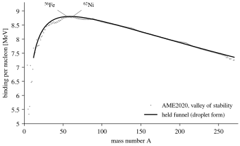
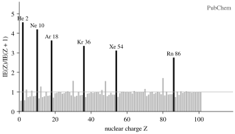
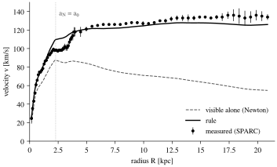
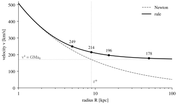
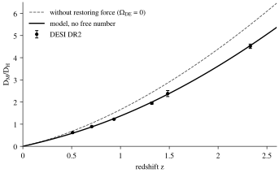

# What Can Be Computed

**Ten examples on our data: from the atom to the whole**

Francesco Silvano Schauer

---

## The Chain

The model computes with few inputs and few formulas. The inputs are the constants of nature (c, G, ħ, the fine-structure constant α), the mass of the body and a single threshold, a₀ = 1.06·10⁻¹⁰ m/s². For the whole, three measured values are added (Planck): the baryons ω_b, the radiation via T_CMB, and ω_c. ω_c is not a substance of its own but the weight of the return in the whole, Q = ω_c/ω_b. Everything else follows.

| What | Formula | What it gives |
|---|---|---|
| Fold | Δs = GM/(3c²) | the measure of mass: the extra length at the centre of the funnel |
| Slope | g = 3c²Δs/r² | the acceleration of fall, Newton |
| Pace | dτ/dt = √(1 − 6Δs/r) | the rate of clocks in the funnel |
| Return | a = a_N/(1 − q), q = e^{−√(a_N/a₀)} | motion at every acceleration: Newton above a₀, flat rotation curves below |
| Threshold radius | r* = √(GM/a₀) | where a body reaches the threshold |
| Breathing | ρ_DE = 3π³a₀²/(30Gc²) | dark energy and with it H₀ and Ω_DE |
| Orbit of the shell | v = αc on a_B | the binding of the atom |
| Holder of the nucleus | a_C = (3/5)·αħc/λ_H | the length on which the nucleus holds its nucleons |

The **return fraction** q is the part of a motion that returns through the inner direction. a_N is the acceleration that Newton alone would give from the visible mass. Above the threshold q is nearly zero and the rule is Newton. Below it q grows and holds the orbits (Figure 1). The threshold is the same everywhere: galaxies, the distances of supernovae and the breathing of the whole read the same number.

What can be computed cleanly in this way:

- **Particles and nucleus:** the binding of hydrogen, the holder length of the nucleus from AME2020, the closure numbers of shells and nuclei, the end of matter at Z = 118.
- **Stars and galaxies:** the rotation curve from the visible alone, the threshold from 141 galaxies (SPARC), the disc length R_d = r*/√2.
- **The whole:** H₀ = 67.2 km/s/Mpc and Ω_DE = 0.685 from a₀ and the three measured values of the whole, the shape of the expansion from supernovae (Pantheon+) and BAO (DESI DR2).

Ten examples follow, step by step, from the atom to the whole.


---

## Example 1: Atom and Nucleus

**Hydrogen.** The shell of hydrogen is a fast-orbiting vortex: it runs with v = αc on the Bohr radius a_B. Its binding is the energy of this orbit, E = ½μv², with μ the reduced mass of electron and proton, because both orbit their common centre of mass:

```
E = ½ · μ · (αc)² = **13.598 eV**
```

Measured (PubChem): **13.598 eV**. No fitted number stands in between.

**The nucleus.** The nucleus is a held funnel. The length on which it holds its nucleons sits in the Coulomb term of the binding. Fitted to all nuclei of AME2020 (Figure 2), this term is a_C = 0.69 MeV, and from it

```
λ_H = (3/5)·αħc / a_C = **1.25 fm**     R(⁵⁶Fe) = λ_H · 56^{1/3} = **4.8 fm**
```

The same length comes by a second, independent route: mirror nuclei, in which protons and neutrons are exchanged, differ only in their winding. Their difference in binding gives **1.33 fm**. And the speed of the nucleons in the holder can be read twice: from the size, v/c ≈ λ̄_p/λ_H = **0.17**, and from the depth of the binding of ⁶²Ni, **0.14**. Size and binding read the same.



---

## Example 2: The Solar System

The funnel of Earth and Sun, without return: all numbers follow from the fold Δs = GM/(3c²) and the clock rate dτ/dt = √(1 − 6Δs/r).

| Body | Fold Δs | Limit radius r₀ = 6Δs | Clock at the surface, lag per year |
|---|---|---|---|
| Earth | 1.478 mm | 8.87 mm | 0.022 s |
| Sun | 492.2 m | 2.95 km | 67 s |

The Earth follows the slope of the Sun's fold: v = c·√(3Δs☉/r) = **29.78 km/s**, one revolution in **365.3 days**. In the Sun's funnel its clock lags by **0.31 s** per year. Light at the solar limb is deflected by **1.7512″**, half by the clock rate and half by the extra length (0.8756″ + 0.8756″). The perihelion of Mercury advances by **42.98″** per century. The threshold of the Sun lies at r* = **7480 AU**, far outside the planets: at the Earth's orbit the addition of the return is e^{−7480}, the solar system is Newton.

---

## Example 3: The Closure Numbers

The shell fills by n + l and closes after 2, 10, 18, 36, 54, 86, 118. The periods are 2, 8, 8, 18, 18, 32, 32 long. The pure 1/r² form would close after 2, 10, 28, 60. The held body closes after 2, 8, 20, 40, 70, 112. With the twist, which pulls down the state of largest winding in every shell, after O(k) + 2(k + 2) = 28, 50, 82, 126, and the next closure would be 184. None of these numbers is fitted, they are counted.

Measured (PubChem): the six strongest drops of the ionisation energy from one element to the next lie exactly after Z = 2, 10, 18, 36, 54, 86, from a factor **4.6** at He to **2.8** at Rn (Figure 3). Measured (AME2020): the six strongest jumps of the two-nucleon binding lie at N = 16, 20, 28, 50, 82, 126 and Z = 14, 20, 28, 38, 50, 82.



---

## Example 4: Stars

**Mass scale.** M_* = m_Pl³/m_p² = **1.853 M☉**: the star as the mirror image of the Planck point at the quantum length of the proton.

**Limiting mass.** If the counting rule of the electrons holds the funnel, it has the form n = 3. Its equation θ″ + (2/ξ)θ′ + θ³ = 0 is integrated from the centre: the edge lies at ξ₁ = **6.897**, the coefficient is ω₃ = −ξ₁²θ′(ξ₁) = **2.018**, and from it

```
M = ω₃·(√(3π)/2)·m_Pl³/(2m_u)² = **1.456 M☉**
```

**Ceiling.** The same funnel reaches at most kT = **0.096**·(μ/μ_e)·m_ec², for carbon and oxygen (μ/μ_e = 7/8) **5.0·10⁸ K**. The burning ladder ends where the binding per nucleon no longer grows, at x = ¼: in the valley at Z = **26.7**, between iron and nickel.

**Carter.** That the star on the mass scale lies at the border of radiation and convection requires α_G ≈ α¹²·(m_e/m_p)⁴: computed **2.0·10⁻³⁹** against α_G = **5.906·10⁻³⁹**, a factor **2.9**, of order one.

---

## Example 5: The Fold

When the shell falls onto the centre, the funnel stays finite. A fold of 10⁶ M☉ in a galaxy has s² = **1.4·10¹⁷** at the horizon: it lies deep in the Newtonian regime, the return acts only outside r* = **36 pc**. The fold of one solar mass has the temperature kT = m̃c²/(4π), T = **6.2·10⁻⁸ K**, a period **2.3·10²²** times shorter than the return (kT_I = ħa₀/c). Its entropy is S = 4πk·(M/m_Pl)² = **1.05·10⁷⁷** k. If it radiates as a black body at its temperature, it lives t = 5120π·α_G·3Δs/c = **2.1·10⁶⁷** years. What falls into it releases, down to the innermost stable orbit, **5.7 %** of its rest energy, **6.1** times as much as nuclear binding up to iron (⁵⁶Fe: **0.94 %**, AME2020). At the meeting point of rotation, j = 1, it is **42 %**. Only at M_U/4 = **1.4·10²³ M☉** do horizon, threshold and closure length coincide.

---

## Example 6: A Galaxy

NGC 2403 is a spiral galaxy with a well-measured rotation curve (SPARC, 73 points, quality 1). The calculation takes only the visible: gas, stellar disc and bulge as SPARC gives them from light and the 21-cm line, with the mass-to-light ratio of the disc Υ_d = 0.67 and of the bulge Υ_b = 0.7, the same for all galaxies. Υ_d is not a quantity of the model but the conversion of light into fold. It follows from the demand that stars and gas obey the same rule. Distance and inclination stay at the catalogue values. Nothing is fitted to this galaxy.

Step by step at each radius:

1. v_bar² = V_gas·|V_gas| + Υ_d·V_disc² + Υ_b·V_bulge²  (the Newtonian speed of the visible)
2. a_N = v_bar²/R
3. a = a_N/(1 − e^{−√(a_N/a₀)}),  v = √(a·R)

| R [kpc] | v_bar [km/s] | a_N/a₀ | v rule [km/s] | v measured [km/s] |
|---|---|---|---|---|
| 0.96 | 61 | 1.20 | 75 | 75 ± 1.0 |
| 2.98 | 85 | 0.74 | 112 | 100 ± 2.7 |
| 5.96 | 81 | 0.33 | 122 | 125 ± 0.9 |
| 9.94 | 71 | 0.16 | 124 | 127 ± 2.6 |
| 14.91 | 64 | 0.08 | 128 | 134 ± 0.6 |
| 19.87 | 55 | 0.05 | 125 | 136 ± 5.6 |

The visible alone falls off outwards, from 85 to 55 km/s. The rule keeps the curve flat, as measured (Figure 4). Over all 73 points the rule lies on average at 1.01 times the measurement, with a scatter of 0.03 dex.



Not every galaxy hits this closely with the catalogue values: NGC 3198, computed the same way, lies on average at 1.16 times. Distance and inclination are measurements with their own error. Over all 141 galaxies they are therefore estimated galaxy by galaxy, and only this full calculation reads the threshold (Example 8).

---

## Example 7: The Milky Way

As a point mass of 6·10¹⁰ M☉ the Milky Way has the fold Δs = **197.4 AU** and the threshold radius r* = **8.88 kpc**. There ν = **1.582**. Deep outside the curve becomes flat, v⁴ = GMa₀: **170.4 km/s**.

| R [kpc] | v Newton [km/s] | v rule [km/s] |
|---|---|---|
| 5 | 227 | 249 |
| 8.88 (r*) | 170 | 214 |
| 15 | 131 | 196 |
| 50 | 72 | 178 |

At 50 kpc the enhancement is ν = **6.14** (Figure 5). A uniform external field does not change it, the Milky Way falls with it. Far outside, the deflection of light tends to α_∞ = 2π·(v_flat/c)² = **0.42″**. The seam, where the local q reaches the cosmic one (a_N = **0.029**·a₀), lies at R_Q = **52.0 kpc**. No region around it binds beyond R_max = v_flat/H_∞ = **3.07 Mpc**, the mean of threshold and closure, with H_∞ = c·√Λ_s, the rate of the end state.



---

## Example 8: The Threshold from 141 Galaxies

Over all **141** galaxies (SPARC, quality 1 or 2, inclination above 30°) with **2688** points, distance, inclination and mass-to-light estimated for each galaxy: the mass-to-light ratio of the discs follows from the demand that stars and gas obey the same rule, Υ_d = **0.67**. Then the threshold reads a₀ = **1.11**·10⁻¹⁰ m/s² (16 to 84 %: 1.00 to 1.21). The Bose form fits best: the simple form is worse by Δχ² = **53**, the standard form by **41**. The return has dimension **0.92** ± **0.05**, one-dimensional as the square root in q requires.

**Discs at the threshold.** The disc scale length is, in the median, **0.71**·r* (16 to 84 %: 0.37 to 1.28), that is r*/√2, and it grows with the baryonic mass as M_b^{0.31 ± 0.02}.

**Single funnel or collective.** Compact globular clusters (g = 25·a₀) show hardly any addition, ν = **1.007**. Thin systems (g = 0.13·a₀) the full one, ν = **3.3**. Pressure-supported spheres have σ_v⁴ = (4/81)·GMa₀: **9.1 km/s** at 10⁷ M☉, **19.3 km/s** at 2·10⁸ M☉. A whole system lies below the threshold at Σ < a₀/(πG) = **242 M☉/pc²**. On the 52 star clusters of the Local Volume Database with measured dispersion the thin ones (g_N < a₀) lie +0.10 ± 0.03 dex above the prediction with the rule, +0.41 with Newton (χ² 53 against 235).

---

## Example 9: The Cosmos

From a₀ alone follows dark energy, ρ_DE = 3π³a₀²/(30Gc²): each of the three loops of the torus carries the restoring of the fold. With ω_b, ω_c and T_CMB, the closed balance gives

```
H₀ = **67.2** km/s/Mpc     Ω_DE = **0.685**     Ω_m = **0.315**
```

This can be tested on a quantity that depends on no calibration: the ratio of transverse to radial distance, D_M/D_H, which DESI measures from the baryon oscillations. In it, the length of the oscillation r_d and H₀ cancel. It reads only the shape of the expansion. The model has no free number here.

```
D_M/D_H(z) = E(z) · ∫₀^z dz′/E(z′)     E(z) = √(Ω_r(1+z)⁴ + Ω_m(1+z)³ + Ω_DE)
```

| z | DESI DR2 | Model |
|---|---|---|
| 0.51 | 0.621 ± 0.017 | 0.594 |
| 0.706 | 0.892 ± 0.021 | 0.878 |
| 0.934 | 1.223 ± 0.019 | 1.252 |
| 1.321 | 1.947 ± 0.045 | 1.997 |
| 1.484 | 2.381 ± 0.136 | 2.351 |
| 2.33 | 4.517 ± 0.097 | 4.548 |

Six values, χ² = 6.8: on average the model lies one measurement error from the data, as a correct prediction should (Figure 6). On all precision data together (background radiation, lensing, DESI, Pantheon+, growth, light nuclei) the whole reads the dark energy today, form part and state part together, as a₀ = 1.085 ± 0.003 when the maximum of the state part lies at the saturation of the loop, with as many free numbers as the standard model and Δχ² = 8.7 below it.



---

## Example 10: The Ladder from a₀

From the threshold alone follow the closure length Λ = c²/(2a₀) = **13.7 Gpc** and the return time τ_D = 2Λ/c = **89.6 billion years**, longer than the age of the universe: the return is a stationary loop at the place. With the Planck length comes the ladder number ε_L = ℓ_P/ℓ₀ = **1.9·10⁻⁶²** and with it the rungs of the ladder of lengths (Figure 7):

| Rung | Mass | where two lengths are equal |
|---|---|---|
| M_min = ε_L·m_Pl | 4.1·10⁻⁷⁰ kg | λ̄ = ℓ₀ |
| M_c = ε_L^{1/3}·m_Pl | 5.8·10⁻²⁹ kg | r* = λ̄ |
| m_Pl | 2.2·10⁻⁸ kg | 3Δs = λ̄ = ℓ_P |
| M_U = m_Pl/ε_L | 1.1·10⁵⁴ kg = 5.7·10²³ M☉ | r* = 3Δs = ℓ₀ |

The breathing: Θ = 2πa₀/(cH₀) = **1.020**, the vacuum part Ω_s = (π²/45)·Θ² = **0.228**. Three loops give Ω_DE, today Ω_DE/Ω_s = **3.03** (read after Planck). The vacuum part is the geometric mean of the Planck density and the quantum density of the closure length: Λ_s·ℓ_P² = (4π⁴/15)·ε_L² = **9.4·10⁻¹²³**. Its time-fixed number is k_s = π³/30 = **1.034**. If it alone carried the expansion, this would run into H_s = H₀·√Ω_s = **32.1 km/s/Mpc**, with three parts into **55.6 km/s/Mpc**. The whole lies with r*/Λ = **0.971** just below its own meeting point. Its cell is L = **27.9 Gpc**.


---

## What the Ten Examples Show

From the atom to the whole, the same chain is used: fold, return, threshold. In the atom, in the nucleus, in the solar system and in the fold the accelerations lie far above the threshold, the return is zero, and fold and clock rate remain. In the galaxies the threshold is crossed, the curves stay flat, and 141 galaxies read it as one number. In the whole the same threshold is the restoring itself. It sets the ladder of lengths and the expansion. None of the ten examples needs a number chosen specifically for it.
